# تطبيق إدارة حسابات العملاء والموردين 📊💼

تطبيق متكامل مبني باستخدام إطار العمل **Flutter** وقاعدة بيانات **Supabase** لإدارة العمليات المالية والطلبات والحسابات بين العملاء، تجار التجزئة، والموردين. تم تطوير هذا المشروع كـ **مشروع تخرج** لتقديم حل تقني متطور ومنظم لإدارة المعاملات التجارية والديون والتقارير المالية.

---

## 📸 لقطات من التطبيق (Screenshots)

> **ملاحظة:** يمكنك العثور على جميع الصور التوضيحية داخل مجلد `screenshots`.

| الشاشة التعريفية | شاشة تسجيل الدخول | شاشة المنتجات |
|:---:|:---:|:---:|
| 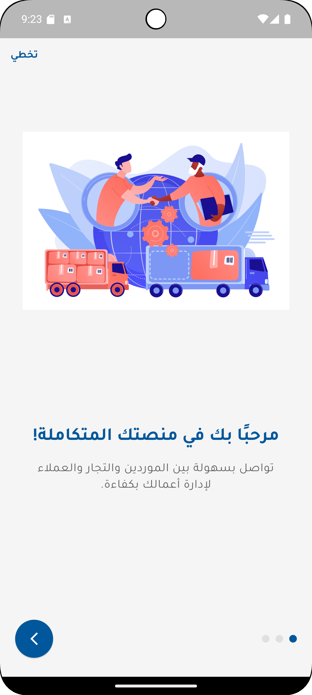 |  | 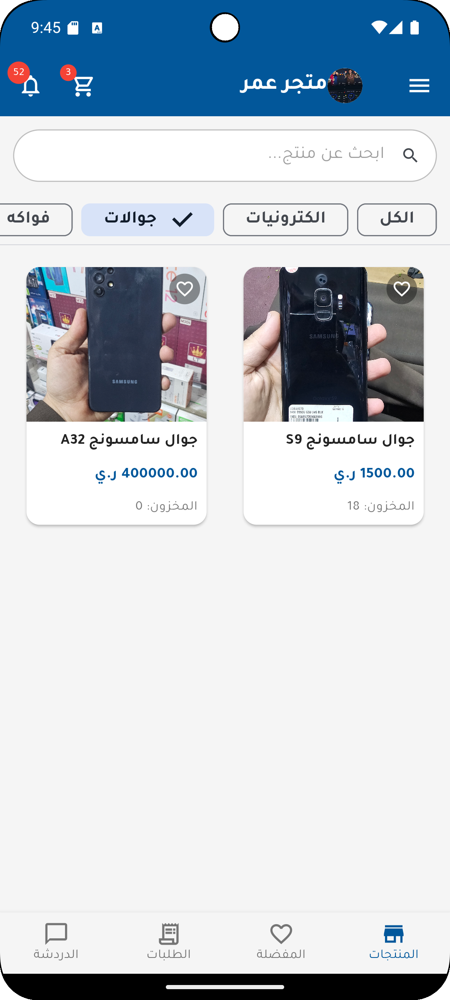 |

| تفاصيل المنتج | الشاشة الرئيسية للتاجر | تقرير الحسابات المالية |
|:---:|:---:|:---:|
| 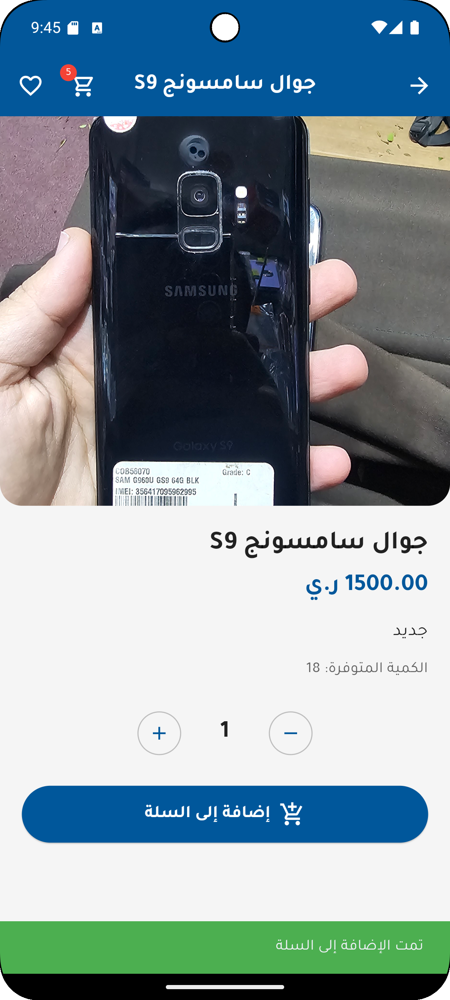 | 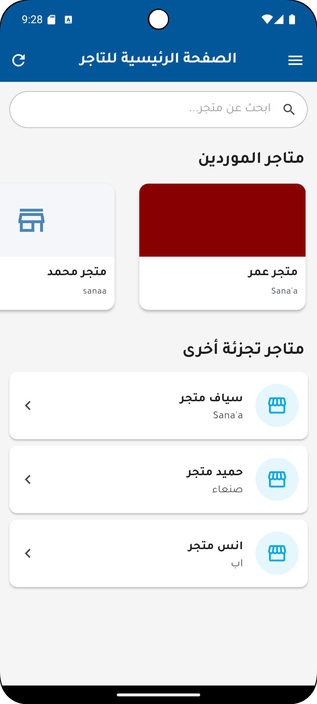 | 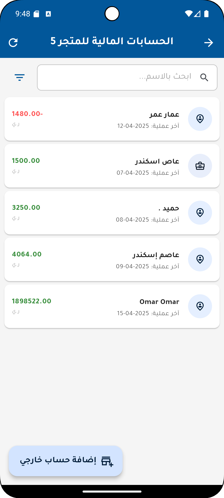 |

---

### 🎨 تصاميم ومخططات الـ UI/UX (UI/UX Prototypes)

> **ملاحظة:** يمكنك الاطلاع على التصاميم والنماذج الأولية للواجهات داخل مجلد `ui_ux_design`.

| نموذج الواجهة 1 | نموذج الواجهة 2 | نموذج الواجهة 3 |
|:---:|:---:|:---:|
| 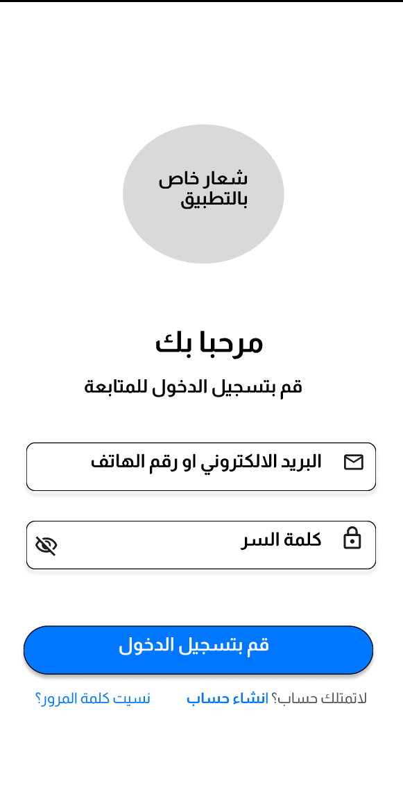 | 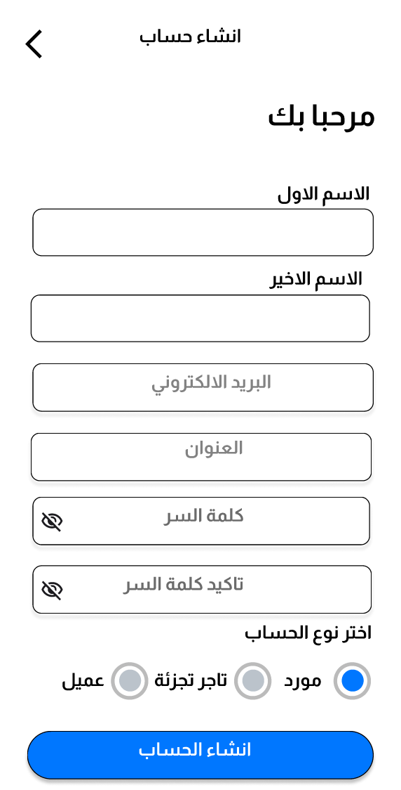 | 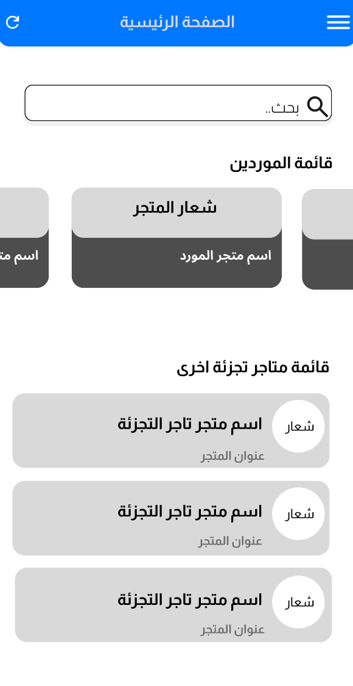 |

| نموذج الواجهة 4 | نموذج الواجهة 5 | نموذج الواجهة 6 |
|:---:|:---:|:---:|
| 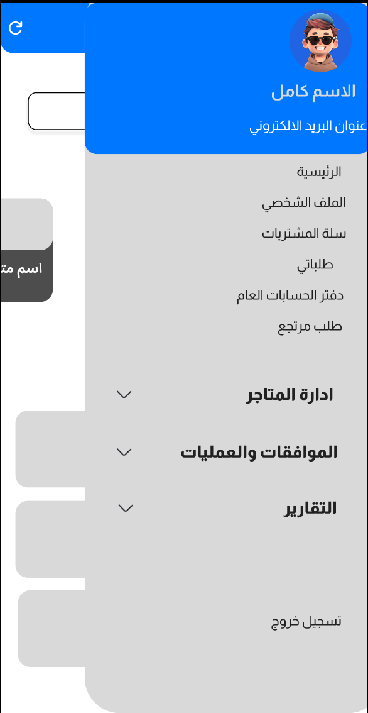 | 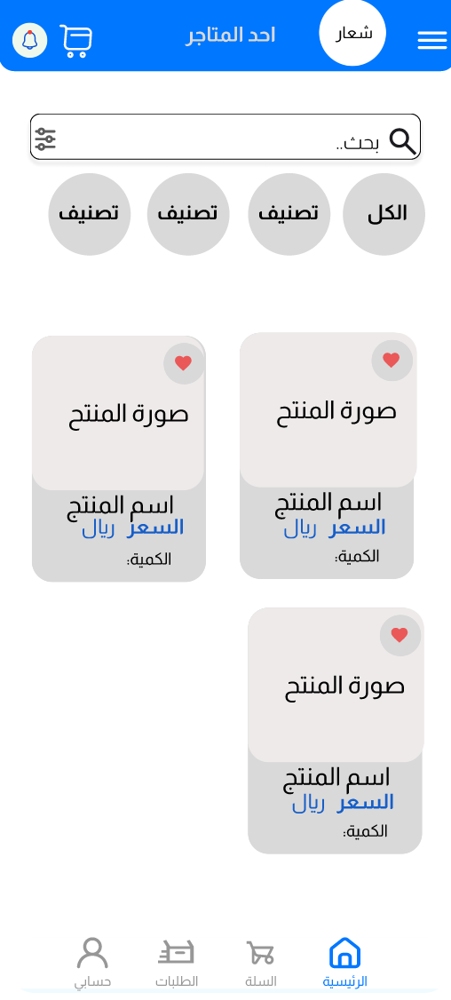 | 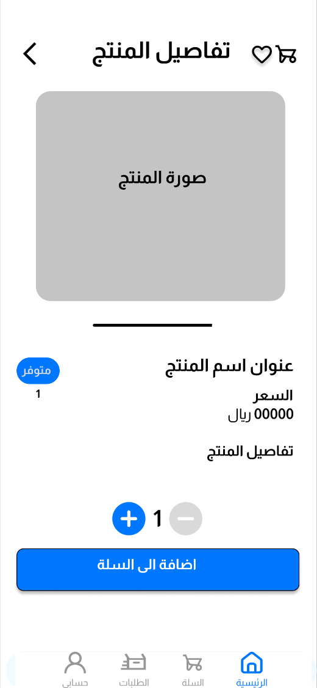 |

---

## ✨ المميزات الرئيسية (Key Features)

1. **نظام صلاحيات متعدد الأدوار (Multi-Role Authentication):**
   * **العميل (Client):** تصفح المنتجات، تقديم الطلبات، ومتابعة الفواتير.
   * **تاجر التجزئة (Retailer):** إدارة المنتجات، الموافقة على الطلبات، التعامل مع الموردين، وإدارة المديونيات.
   * **المورد (Supplier):** توفير المنتجات لتجار التجزئة، ومتابعة المعاملات المالية الآجلة والنقدية.
2. **إدارة الطلبات وسلة التسوق (Order & Cart Management):**
   * نظام متكامل لإضافة المنتجات إلى السلة، اختيار نوع الدفع (نقدي / آجل)، وتقديم الطلبات.
3. **نظام المرتجعات المتقدم (Return Management):**
   * إمكانية تقديم طلبات إرجاع المنتجات مع تتبع حالة الطلب وتحديث المخزون تلقائياً بعد الموافقة.
4. **التقارير المالية والحسابات (Financial Reports & Accounts):**
   * كشوفات حساب مفصلة لكل عميل ومورد، تتبع الديون (الدفع الآجل)، وتصدير التقارير.
5. **نظام الإشعارات الفورية (Real-time Notifications):**
   * تنبيه المستخدمين عند تحديث حالة الطلبات، قبول المرتجعات، أو حدوث أي عملية مالية جديدة.
6. **دعم تعدد العملات (Multi-Currency Support):**
   * التعامل بأكثر من عملة وتحديث الحسابات بناءً على العملة المحددة.
7. **واجهة مستخدم احترافية بالكامل (Premium UI/UX):**
   * تصميم متناسق ومريح يدعم اتجاه الكتابة من اليمين إلى اليسار (RTL) مع خط **Tajawal** المميز.

---

## 🛠️ التقنيات المستخدمة (Tech Stack)

* **إطار العمل الأساسي:** [Flutter (Dart)](https://flutter.dev/) لبناء واجهات التطبيق للهواتف الذكية.
* **إدارة حالة التطبيق (State Management):** [Provider](https://pub.dev/packages/provider) لضمان سلاسة الأداء وتحديث البيانات الفوري.
* **Backend وقاعدة البيانات:** [Supabase](https://supabase.com/) (تضم Database, Authentication, and Storage).
* **إدارة البيانات المحلية:** [Shared Preferences](https://pub.dev/packages/shared_preferences).
* **أيقونات وتصميم:** حزم مخصصة مثل `flutter_svg` و `smooth_page_indicator`.

## 📂 هيكل المشروع (Project Structure)

يحتوي المستودع على مجلدين رئيسيين:
* 📱 **[mobile_app](./mobile_app):** يحتوي على تطبيق الهاتف المبني بإطار العمل Flutter.
* 💻 **[admin_panel](./admin_panel):** يحتوي على لوحة تحكم الأدمن لمتصفح الويب (HTML/CSS/JS).

---

## ⚙️ تشغيل المشروع محلياً (How to Run)

### 📱 أولاً: تشغيل تطبيق الهاتف (mobile_app)

1. **الانتقال لمجلد التطبيق:**
   ```bash
   cd mobile_app
   ```

2. **تهيئة ملف الإعدادات البيئية (`.env`):**
   * قم بإنشاء ملف جديد باسم `.env` داخل مجلد `mobile_app`.
   * انسخ محتويات الملف `.env.example` بداخله وضع روابط ومفاتيح Supabase الخاصة بك:
     ```env
     SUPABASE_URL=رابط_مشروع_سوبابيز
     SUPABASE_ANON_KEY=مفتاح_anon_الخاص_بالمشروع
     ```

3. **تحميل الحزم البرمجية:**
   ```bash
   flutter pub get
   ```

4. **تشغيل التطبيق:**
   ```bash
   flutter run
   ```

### 💻 ثانياً: تشغيل لوحة التحكم (admin_panel)

1. **تهيئة ملف الإعدادات (`config.js`):**
   * انتقل إلى المجلد `admin_panel/js/`.
   * قم بإنشاء ملف جديد باسم `config.js`.
   * انسخ محتويات الملف `config.example.js` بداخله وضَع روابط ومفاتيح Supabase الخاصة بك (نفس المستخدمة في التطبيق):
     ```javascript
     export const SUPABASE_URL = 'رابط_مشروع_سوبابيز';
     export const SUPABASE_ANON_KEY = 'مفتاح_anon_الخاص_بالمشروع';
     ```

2. **تشغيل اللوحة:**
   * يمكنك تشغيل اللوحة مباشرة بفتح ملف `index.html` في أي متصفح ويب، أو تشغيلها عبر خادم محلي (Local Server) مثل Live Server في VS Code.

---

## 🎓 مشروع التخرج

تم تطوير هذا التطبيق كمشروع تخرج لنيل درجة البكالوريوس.

* **أعضاء الفريق:**
  * **أنس طه محسن العامري**
  * **عاصم محمد حمود قاسم غالب**
  * **باسل حامد بورجي**
  * **حميد منصور البطل**
* **تحت إشراف:**
  * **أ. نايف الحنق**

---

## 🙋‍♂️ دوري ومساهمتي في المشروع - أنس العامري (My Contributions)

بصفتي أحد المطورين الأساسيين في المشروع، تركزت مساهماتي في الجوانب التالية:

* 🎨 **تصميم وتحسين واجهات المستخدم (UI/UX Design & Improvement):**
  * عمل التصاميم الأولية لواجهات التطبيق (UI/UX Design).
  * تحسين وتطوير المظهر العام للواجهات وتناسقها في بيئة Flutter لضمان تجربة مستخدم سلسة ومريحة.
* ⚖️ **برمجة منطق القيد المزدوج (Double-Entry Accounting Logic):**
  * بناء وبرمجة المنطق الحسابي الخاص بإنشاء القيود المزدوجة تلقائياً في قاعدة البيانات عند إجراء الطلبات الآجلة (Deferred/Credit Orders) لضمان توازن الحسابات المالية بدقة.
* 🛒 **تحسين منطق سلة التسوق (Cart Logic Optimization):**
  * تحسين وتطوير منطق إدارة المنتجات داخل السلة، وحساب الإجماليات بشكل لحظي، وتسهيل عملية الانتقال لإتمام الطلب.
* 🌐 **الربط البرمجي وتهيئة العمليات:**
  * المساهمة في ربط الواجهات والعمليات الحسابية مع جداول قاعدة بيانات Supabase وإدارة العمليات المالية المختلفة.

